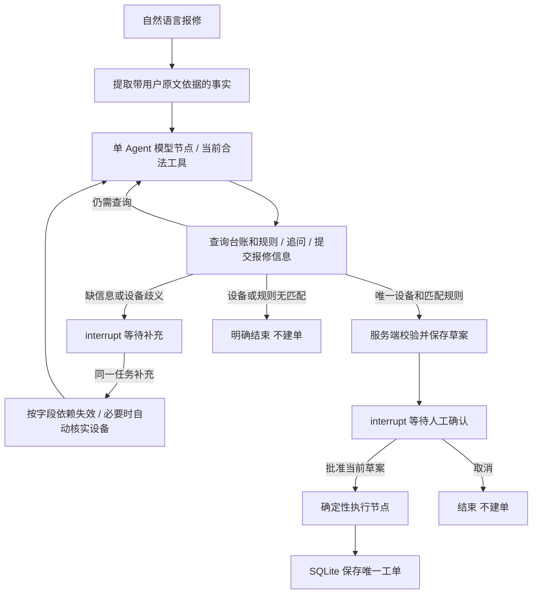

# 制造设备报修与工单流转智能体

面向智能体开发工程师实习申请的可演示项目：用 Python、LangGraph、模型工具调用、FastAPI、SQLite 和 Streamlit 实现“自然语言报修 → 核对设备与规则 → 追问或草案 → 人工确认 → 创建工单”。Docker Compose 提供本地双服务启动和持久化卷。

**设备、位置、班组、规则和工单全部为模拟业务数据。系统只处理分类、派单与流转，不提供设备维修操作指导，也不控制真实设备。**

当前已完成本轮修复：**114 条测试通过，原 12 条 WSL 真实评测 12/12，新增不同表述评测 4/4，容器真实探针及 HTTP 三场景全部通过**。模型保持 `gpt-4o-mini`，原六轮限制、用例及预期不变，所有历史结果保留。各类证据分别记录在 [修复报告](reports/repair_report.md)，不能用 mock 结果替代真实调用；云部署未验证。

## 核心流程与职责



本项目只有一个 Agent。模型理解报修语义、确定故障类别并提出工具参数。每轮只绑定当前合法的 `lookup_asset`、`lookup_rules`、`ask_user` 或 `propose_draft` 子集，设置 `parallel_tool_calls=False`；**模型不能调用 `create_work_order`**。服务端仍检查实际响应，非法名称、批次或参数逐条拒绝、返回 ToolMessage 并保存审计，不静默丢弃。

`facts.py` 仅从用户消息提取带原文来源的设备线索、故障描述和停机情况；模型自己提出的“已停机”不能变为确认事实。模型看到这些事实、缺失字段及设备/规则核实状态，只追问尚缺失或冲突的受理字段。草案故障描述保留用户原句，避免切分逗号破坏否定范围。

停机/故障变化使规则与草案失效，已核实设备可保留；设备引用或消歧位置变化则保守重核设备。补充后需要重查时，graph 在下次模型请求前执行只读台账查询，记录 `automatic_tool`；它不产生隐藏模型调用。旧 checkpoint 缺少新 facts 字段的恢复路径也有回归测试。设备 ID 精确解析，ID＋名称/位置须一致；多 ID、身份冲突需澄清，未知 ID 不回退到另一设备。

服务端决定业务事实：设备必须存在于台账，歧义查询直接进入追问，零匹配直接报告无法受理；设备查询词需来自用户提供的设备事实。规则匹配同时检查故障类别、停机状态、设备类型和设备允许的班组。草案中的位置、优先级、班组和规则 ID 由服务端计算，不接受模型或用户任意指定的派单结果。无匹配规则时不编造替代依据。

模型仍负责故障语义分类；事实提取采用保守启发式，复杂否定、时间关系、部件与设备名的歧义及未识别表述仍可能需要澄清。这些有限用例的通过不能证明系统理解了所有报修语句。

模拟数据包含 10 台设备、3 个班组、6 条规则。规则覆盖机械、电气、控制三类与停机/未停机的组合；`other` 类刻意保留无匹配规则场景。`P1`、`P2`、`P3` 是演示自定义等级，`P1` 最高，不代表企业正式标准。完整数据与评测约定见 [evals/README.md](evals/README.md)。

## 人工确认、持久化与防重复

- `wait_info` 和 `approval` 节点用 LangGraph `interrupt` 暂停；补充、确认和取消均使用同一 `task_id` 作为 `thread_id`，通过 `Command(resume=...)` 恢复。
- 草案先保存到服务端。`draft_id` 是包含任务 ID 和草案字段的 SHA-256 摘要；批准请求必须带服务端返回的当前 `draft_id`，不能在批准时附带修改后的班组或优先级。它用于绑定草案版本，不是身份认证或数字签名。
- 只有已批准的 `execute` 节点调用 `create_work_order`。执行时读取已保存的草案，不重新调用模型。存储层再次检查批准记录和保存草案是否一致。
- 工单表以 `task_id` 作为唯一 `request_key`。重复确认或建单提交后发生故障再重试，应返回同一工单；取消路径不创建工单。
- `runtime/checkpoints.sqlite` 保存 LangGraph 状态、消息及中断；`runtime/business.sqlite` 保存任务、当前草案、批准决定、工单和事件记录。这两个数据库独立，不共享一次原子事务，因此业务唯一键与重试校验仍然必要。
- 工具实际名称、参数、结果摘要、执行状态及状态变化保存在业务事件表。模型调用错误记录脱敏错误类别、异常类型及允许的状态信息，不记录可能包含凭证或请求地址的原始异常文字。

后端按演示规模使用一个 Uvicorn worker，并以进程内锁加本地文件锁串行访问服务，避免同时恢复同一 SQLite 流程。不要将它视为分布式锁或高并发方案。

每个任务最多 **6 轮 Agent 工具交互**，包括查询、追问和补充信息之后的轮次；计数保存在 checkpoint 中，不因补充或重启而清零。一轮对应一次模型调用响应，正常协议只允许一个工具。需要继续调用模型但已达到上限时，返回 `limit_reached`，不能开启第七轮；已形成的草案仍可人工批准。确定性自动核实步骤单独计数并记录工具名、参数和结果，不冒充模型轮次。

## 本地启动（推荐 WSL Ubuntu）

当前工作目录位于 Windows 的独立项目文件夹，WSL 中对应：

```bash
cd /mnt/c/Users/LENOVO/Desktop/project2/maintenance-agent
```

使用 Python 3.12 和 `uv`。所有直接与间接 Python 依赖由 `uv.lock` 锁定；不要为重现演示随意重新解析版本。

```bash
uv sync --frozen
```

本机 `.env` 已按授权仅复用 RAG 项目的 CHAT 模型三项配置，没有新建 Key 或迁移 embedding 设置；新检出项目从 `.env.example` 复制。密钥只保留在本机 `.env`，不进入源码、命令行参数、截图或报告；`.env` 已加入忽略规则。

| 环境变量 | 用途 |
| --- | --- |
| `LLM_MODEL` | 现有可用 API 的模型名，必须支持工具调用 |
| `LLM_BASE_URL` | 兼容 OpenAI Chat Completions 的 API 地址，按供应商要求填写，例如以 `/v1` 结尾 |
| `LLM_API_KEY` | 本机密钥，不提交 |
| `LLM_TIMEOUT_SECONDS` | 单次模型请求超时，默认 45 秒 |
| `DATABASE_DIR` | SQLite 与文件锁目录，默认项目 `runtime`；从模板加载时为相对当前目录的 `runtime` |
| `API_BASE_URL` | Streamlit 启动进程环境中的 FastAPI 地址，默认 `http://127.0.0.1:8000`，也可在界面侧栏修改 |

模型与数据库设置通过 `Settings` 加载，进程环境变量优先于 `.env`。Streamlit 的 `API_BASE_URL` 读取启动进程环境。模型适配器使用 `langchain-openai`，绑定工具并传入 `tool_choice="required"`；真实 API 必须兼容这一调用方式。API 不支持相关参数、认证失败或网络不可用时会如实失败，不自动降级成假响应。

先运行真实工具调用探针：

```bash
uv run --frozen python scripts/probe_model.py
```

探针要求模型实际请求 `lookup_asset(query="EQ-001")`，再执行模拟台账查询并检查结果，报告保存到 `reports/model_probe.json`。它只证明这一最小调用链可用，不代表 12 条业务用例都通过。无配置退出码为 2，执行失败为 1，通过为 0。

### 命令行

```bash
uv run --frozen python -m maintenance_agent.cli health
uv run --frozen python -m maintenance_agent.cli create "EQ-001 机械轴承异响，已经停机。"
uv run --frozen python -m maintenance_agent.cli get TASK_ID
uv run --frozen python -m maintenance_agent.cli respond TASK_ID provide_info --text "已经停机。"
uv run --frozen python -m maintenance_agent.cli respond TASK_ID confirm --draft-id DRAFT_ID
uv run --frozen python -m maintenance_agent.cli orders
```

将 `TASK_ID` 和 `DRAFT_ID` 替换为实际返回值。取消使用 `respond TASK_ID cancel`。只有 `question` 状态接受补充信息；草案形成后进入 `awaiting_confirmation`。

### FastAPI 与 Streamlit

从项目根目录分别在两个 WSL 终端启动：

```bash
uv run --frozen uvicorn maintenance_agent.api:app --host 127.0.0.1 --port 8000 --workers 1
```

```bash
uv run --frozen streamlit run src/maintenance_agent/ui.py --server.address 127.0.0.1 --server.port 8501 --browser.gatherUsageStats false
```

打开 [Streamlit 界面](http://localhost:8501) 或 [FastAPI 交互文档](http://localhost:8000/docs)。Streamlit 仅通过 HTTP 调用后端，展示追问、草案、规则依据、工具记录及最终工单编号。记录任务 ID 后可在侧栏恢复任务；业务状态不依赖浏览器 session。

| 方法与路径 | 请求/作用 |
| --- | --- |
| `POST /tasks` | `{"text":"EQ-001 机械异响，已经停机。"}` 创建任务 |
| `GET /tasks/{task_id}` | 查询状态、草案、依据、计数和事件 |
| `POST /tasks/{task_id}/responses` | `{"action":"provide_info","text":"已经停机。"}` 补充 |
| 同上 | `{"action":"confirm","draft_id":"服务端当前版本"}` 批准 |
| 同上 | `{"action":"cancel"}` 取消 |
| `GET /work-orders` | 查询工单列表 |
| `GET /work-orders/{order_id}` | 查询单张工单 |
| `GET /health` | 数据库健康与是否配置模型；不会调用模型验证凭证 |

创建任务是同步处理，最多可能等待多轮模型请求。`201` 表示任务已建立，实际业务结果应读取响应中的 `status`。模型配置缺失会返回明确的业务错误状态。参数格式错误通常返回 `422`，状态/草案冲突为 `409`，不存在的资源为 `404`。

## Docker 本地部署

需要可用的 Docker Engine 与 Compose 插件。本机镜像已构建，可从项目根目录直接启动；首次检出或修改代码后先构建：

本次已在 WSL Ubuntu 安装 Docker Engine。若普通用户无 Docker socket 权限，在下面的 Docker 命令前加 `sudo`；无需给已有项目改配置。

```bash
# 首次构建或修改代码后使用；本机已有已验证镜像时可跳过
docker compose build
# 出口可直连的环境使用base；当前机器应使用下文runtime代理覆盖启动
docker compose up -d
docker compose ps
docker compose logs --tail 100 api
```

API 和 UI 使用同一镜像；API 使用 `.env` 配置，UI 通过容器网络访问 `http://api:8000`。宿主机只绑定 `127.0.0.1:8000` 和 `127.0.0.1:8501`，适合本机演示。镜像内使用非 root 用户和单 worker；Python 依赖按锁文件安装。

命名卷 `maintenance-data` 挂载到 API 的 `/app/runtime`，保存两个 SQLite 数据库和锁文件。`docker compose restart api` 后，可以用原任务 ID 恢复待确认任务；`docker compose down` 停止服务时保留数据卷。**不要在需要保留演示数据时使用 `docker compose down -v`，它会删除卷。**

历史 [容器 mock 报告](reports/container_smoke.json) 验证健康、恢复与幂等；本轮 [容器真实探针](reports/network_fix_probe_latest.json) 和 [HTTP 三场景](reports/network_fix_business_latest.json) 使用真实模型，分别验证网络/工具协议和正常确认、补充确认、取消。两类证据分开报告。云环境未验证。

本机直连下载极慢，实际构建使用了可选的 `compose.build-proxy.yaml`。确认当前代理为无认证信息的本机端点后，可用下面的命令替代构建步骤；参数只引用现有环境变量名称，项目不保存代理值，运行时仍使用普通容器网络：

```bash
docker compose -f compose.yaml -f compose.build-proxy.yaml build \
  --build-arg HTTP_PROXY --build-arg HTTPS_PROXY \
  --build-arg http_proxy --build-arg https_proxy \
  --build-arg NO_PROXY=localhost,127.0.0.1 \
  --build-arg no_proxy=localhost,127.0.0.1
# 当前机器构建后，按下文runtime覆盖启动，避免丢失容器出网配置
```

在 WSL 演示时保持一个普通 Ubuntu 终端会话开启；本次另保留了后台 WSL 会话。仅 systemd 服务本身不会保持 WSL 存活，参见 [Microsoft 官方说明](https://learn.microsoft.com/en-us/windows/wsl/systemd)。不需要修改 WSL 全局设置。

### 当前机器的容器运行时代理

现有代理由 Windows verge-mihomo 监听回环地址，WSL 能连接；容器内的 `127.0.0.1` 不能代表该主机代理。项目中继仅绑定本项目 Docker bridge 网关，允许本项目子网访问，不监听 LAN、不记录流量、不保存代理值或凭证。先保持原代理软件运行，按以下顺序操作（Docker 命令需相应权限）：

```bash
# 已有项目network时直接检查；首次在镜像构建后先docker compose create api ui
.venv/bin/python scripts/runtime_proxy.py --inspect
```

在普通 WSL 用户终端运行并保持中继：

```bash
.venv/bin/python scripts/runtime_proxy.py --serve
```

在另一具备 Docker 权限的 WSL 终端：

```bash
export MAINTENANCE_PROXY_GATEWAY="$(python3 -c 'import json; print(json.load(open("reports/network_fix_topology.json"))["gateway"])')"
docker compose -f compose.yaml -f compose.runtime-proxy.yaml up -d --force-recreate --wait api ui
.venv/bin/python scripts/probe_runtime.py
.venv/bin/python scripts/probe_runtime.py --internal-only
```

API 才获得运行时代理环境，API/UI 的 NO_PROXY 覆盖内部服务；已实测内部 HTTP 不进入中继、模型调用会增加中继连接计数。以后重建仍要带 `compose.runtime-proxy.yaml`，单用 base force-recreate 会移除代理环境。网关或代理改变后重新 inspect/启动；helper 仅支持当前无凭证回环 HTTP 代理，不是生产代理服务。见 [网络核验与启动细节](reports/network_fix.md)。

`reports/network_fix_topology.json` 和 `reports/network_fix_relay_stats.json` 是 helper 生成的本机拓扑与实时计数文件，不纳入 Git；时间戳探针与业务验证报告中的脱敏结果保留。

可重跑本地容器检查（当前用户需有 Docker 权限）：

```bash
uv run --frozen python scripts/container_smoke.py
```

该检查会创建明确标注的模拟任务、重启本项目 API、确认一单并取消另一单，数据保留在命名卷中。

## 验证与结果

[12 条任务用例](evals/cases.json) 在模型调试前冻结，覆盖正常报修、信息缺失、设备歧义、未知设备、无匹配规则、取消和指令注入。预期结果与检查口径见 [评测说明](evals/README.md)。

```bash
uv run --frozen pytest
uv run --frozen ruff check .
uv run --frozen python scripts/evaluate.py
uv run --frozen python scripts/evaluate.py --cases evals/generalization_cases.json --reports reports/generalization_eval
```

`pytest` 使用脚本化模型替身，运行真实 LangGraph 和 SQLite，验证未批准不建单、取消不建单、重复确认只建一次、重启恢复待确认、错误草案 ID、工具与规则边界等。这些是 **mock 集成测试**，与真实模型效果分别报告；执行结果见 [验证记录](reports/validation.md)。

`scripts/evaluate.py` 使用 `.env` 的真实模型逐条运行，数据库隔离在 `reports/eval-runtime/<run_id>/<case_id>/`。程序检查状态、设备/优先级/班组/规则、落库数量、草案与规则一致性、批准时不再次调用模型等；逐条保留通过和失败的检查、实际值、调用次数、工具记录和耗时。每次生成时间戳报告并更新 `reports/real_eval/latest.json`，旧报告不覆盖。

原 12 条 [WSL 真实评测](reports/real_eval/latest.json) 单次 **12/12 通过**：33 次模型请求、0 API 错误、0 工具拒绝、0 重复追问、0 六轮耗尽、3 次独立自动核实，63.660 秒。四条 [不同表述评测](reports/generalization_eval/latest.json) 单次 **4/4 通过**：13 次模型请求、3 自动步骤、32.365 秒。旧 6/12、37 请求、17 拒绝、3 耗尽、52.827 秒的 [原始基线](reports/real_eval/20261030T121646787416Z.json) 和早期 blocked 报告全部保留。请求减少没有带来本次端到端耗时改善；未反复运行挑选最好成绩。完整口径见 [修复对比](reports/repair_report.md)。

## 代码导航与演示

| 路径 | 职责 |
| --- | --- |
| `src/maintenance_agent/config.py`、`llm.py` | 环境配置、模型适配、工具 schema 和提示词 |
| `domain.py` | Pydantic 报修信息与草案、台账查询、确定性规则 |
| `facts.py` | 带用户原文依据的事实、缺失字段及保守的设备引用提取 |
| `graph.py` | 单 Agent 循环、轮数限制、追问、审批中断和执行 |
| `store.py`、`service.py` | SQLite 业务存储、幂等、任务恢复和串行锁 |
| `api.py`、`ui.py`、`cli.py` | HTTP 接口、Streamlit 客户端和命令行 |
| `data/`、`evals/`、`tests/` | 模拟业务数据、冻结用例、mock 集成测试 |
| `scripts/`、`reports/` | 真实工具探针、评测脚本及执行证据 |

面试演示按 [3 分钟演示步骤](docs/demo.md) 进行：展示工具调用与规则依据、批准前无工单、确认/取消、同任务重启恢复，最后展示相互独立的 mock 测试和真实模型评测证据。模型未配置时，只能展示实现和 mock 验证，不声称已完成真实模型演示。

## 参考来源与限制

结构参考 [LangChain Agents From Scratch](https://github.com/langchain-ai/agents-from-scratch) 的基础 Agent 和 human-in-the-loop 模式；固定参考提交、具体源码及官方文档链接见 [docs/references.md](docs/references.md)。上游使用 MIT 许可；本项目未复制上游整段源码。后续若复制或实质改编，应保留上游完整版权及许可信息。

当前限制包括：仅完成这些固定和新增用例的单次验证，不能保证其他语言表述都正确；事实解析保守且采用启发式，复杂否定/时间关系/罕见名称可能需要澄清；当前网络中继依赖既有代理及其运行中的 WSL 会话，不是生产网络方案；无鉴权，仅供 localhost 演示；SQLite、小数据量、文件锁和单 worker 不适用于多副本高并发；不包含企业资产系统或真实工单平台集成。不包含模型训练、多 Agent、向量检索或真实设备控制，也没有已验证的云部署。
